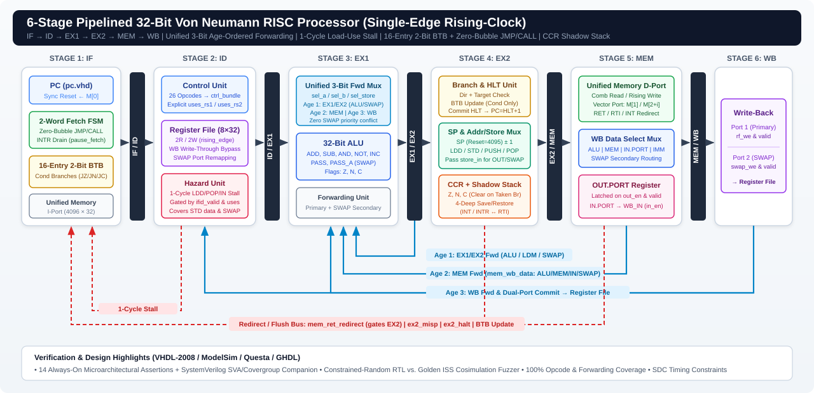

# 6-Stage Pipelined 32-Bit Von Neumann RISC Processor

[](https://github.com/AntonMagdy111/6-stage-Pipelined-Risc-processor/actions/workflows/ci.yml)


A 32-bit, 6-stage pipelined Von Neumann RISC processor (`IF -> ID -> EX1 -> EX2 -> MEM -> WB`) written in synthesizable VHDL-2008 with a custom 26-instruction ISA, unified 4096 × 32-bit memory, strictly age-ordered data forwarding, 1-cycle load/pop/in-use stalling, early zero-bubble `JMP`/`CALL` steering, a 16-entry 2-bit saturating BTB conditional branch predictor, hardware/software interrupts with a 4-deep `CCR` shadow stack, and a full **constrained-random RTL vs. Golden-ISS cosimulation & assertion verification suite**.



---

## Microarchitectural Highlights

| Subsystem | Implementation |
|---|---|
| **Clocking & Synthesis** | 100% single-edge `rising_edge(clk)` across all pipeline registers, `RegisterFile` (with same-cycle WB write-through bypass), `Memory`, `SP`, `CCR`, `BTB`, and `outPutReg`. Synthesizable synchronous reset in `pc.vhd` (`M[0]` load), synthesis-guarded `Memory.vhd`, and Synopsys Design Constraints ([constraints/processor.sdc](constraints/processor.sdc)). |
| **Forwarding Network** | Unified 3-bit strictly age-ordered `EX1` selector (`EX1/EX2 > EX2/MEM > MEM/WB > RF`) covering ALU, `LDM`, `LDD`, `POP`, `IN`, and both primary & secondary `SWAP` writeback ports, plus a **0-stall `WB -> MEM` store/output bypass** for `PUSH`, `OUT`, and `STD` store data. |
| **Hazard Detection** | Strict theoretical-minimum 1-cycle load/pop/in-use stall gated by `not flush_front`, `ifid_valid`, and explicit `uses_rs1`/`uses_rs2` (EX1 consumers only) — zero spurious stalls on bubbles, unused `R0` fields, flushes, or `LDD/POP/IN -> OUT/PUSH/STD-data`. |
| **Branch Prediction & Control Flow** | Early zero-bubble `PC` steering in `IF` on word 2 of `JMP`/`CALL` (0 mispredicts even on cold calls); 16-entry 2-bit saturating BTB reserved strictly for conditional branches (`JZ`, `JN`, `JC`) with both direction and target verification in `EX2`. |
| **Interrupts & `HLT`** | Rising-edge latched hardware `INTR` pauses fetch (`pause_fetch`) to drain older instructions cleanly before pushing exact return `PC` and jumping to `M[1]`; software `INT 0/1` jumps via `M[2]`/`M[3]`; 4-deep internal `CCR` shadow stack preserves flags across nested `INT`/`INTR` -> `RTI`. `HLT` commits in `EX2` gated by `mem_ret_redirect` and freezes `PC` at `HLT + 1`. |

---

## Verification & Functional Coverage Closure

The processor is verified with a multi-layer Design Verification (DV) flow modeled on industry EDA methodologies (Siemens Questa / ModelSim / GHDL):

1. **14 Always-On Microarchitectural Assertions** embedded in [Processor.vhd](Processor.vhd) (synthesis-guarded) checking simultaneous memory R/W exclusion, bubble-stall absence, wrong-path `EX2` state gating on `RET`/`RTI`/`INT`, BTB purity, missed load-use bypass detection, X-propagation freedom, and post-`HLT` freeze invariants — **0 assertion failures across >12,350 simulated cycles**.
2. **SystemVerilog Assertions (SVA) & Covergroup Companion** in [verification/cpu_sva.sv](verification/cpu_sva.sv) (`vlog -sv` clean) ready for mixed-language Siemens Questa simulation and formal property checking (`Questa PropCheck`).
3. **Constrained-Random RTL vs. Golden-ISS Cosimulation Fuzzer** ([verification/cosim_fuzzer.py](verification/cosim_fuzzer.py)) generating 50 randomized multi-hazard assembly programs mixing all 26 opcodes, RAW chains, `LDD`/`STD`, balanced `PUSH`/`POP`, `SWAP` overwrites, `IN`/`OUT`, forward branches, loops, `CALL`/`RET`, and `INT 0/1 -> RTI` — comparing `R0..R7`, `SP`, `PC`, `CCR`, `OUT.PORT`, and the full `OUT` sequence bit-for-bit against [isa_sim.py](isa_sim.py).

| Verification Metric | Result |
|---|---|
| VHDL-2008 Compilation (`vcom -2008` / `ghdl --std=08`) | **26 / 26 files — 0 errors, 0 warnings** |
| C++17 Assembler (`g++ -std=c++17 -O2 -Wall -Wextra -Werror`) | **0 warnings** |
| Custom Regression Suite (`sim/run_all_100_tests.do`) | **100 / 100 PASS** (+ `OUT.PORT` verified) |
| Core + Professor Grading Suites (`test_*.mem`, `prof_*.mem`) | **13 / 13 PASS** (exact match on `R0..R7`, `SP`, `PC`, `CCR`, `OUT`) |
| Adversarial Edge-Case Suite (incl. live `intr`, nested `INT`, 0-stall `WB->MEM`) | **16 / 16 PASS** |
| Constrained-Random Cosimulation Fuzzer (`--seeds 50`) + 4 Benchmarks | **67 / 67 PASS — 0 assertion failures** |
| **ISA Opcode Coverage** | **26 / 26 (100.0%)** |
| **Forwarding Mux Coverage (`sel_a`, `sel_b`, `sel_store`)** | **7 / 7 (100.0%) on all 3 operand buses** |

---

## Measured Benchmark Performance (ModelSim RTL)

All 4 benchmark kernels live in [test/benchmarks/](test/benchmarks/) and were assembled with [assembler/assembler.cpp](assembler/assembler.cpp), cosimulated bit-for-bit against [isa_sim.py](isa_sim.py), and profiled cycle-accurately in ModelSim:

| Benchmark | Workload | Retired Instr | Cycles | CPI | IPC | Stalls | Cond. Branches | Mispredicts | BTB Accuracy |
|---|---|---:|---:|---:|---:|---:|---:|---:|---:|
| `bench_fibonacci` | Iterative $F(15) = 610$ | 96 | 139 | **1.45** | 0.69 | 0 | 15 | 2 | **86.7%** |
| `bench_array_sum` | 12-word RAM write + stream sum ($78$) | 128 | 245 | **1.91** | 0.52 | 12 | 24 | 4 | **83.3%** |
| `bench_recursive_sum` | 10-level recursive `CALL`/`RET` sum ($55$) | 89 | 184 | **2.07** | 0.48 | 10 | 11 | 1 | **90.9%** |
| `bench_bubble_sort` | 6-element in-memory Bubble Sort w/ `SWAP` | 263 | 542 | **2.06** | 0.49 | 25 | 55 | 16 | **70.9%** |

*(Note: 2-word immediate instructions fetch over 2 cycles across the 32-bit Von Neumann instruction port, setting the theoretical baseline CPI of immediate-heavy code between 1.3 and 1.8.)*

---

## Quick Start

### 1. Build the C++17 Two-Pass Assembler
```sh
g++ -std=c++17 -O2 -Wall -Wextra -Werror assembler/assembler.cpp -o assembler/assembler
./assembler/assembler test/benchmarks/bench_fibonacci.asm test/benchmarks/bench_fibonacci.mem
```

### 2. Run the Python Golden ISA Simulator
```sh
python3 isa_sim.py test/benchmarks/bench_fibonacci.mem
# For tests consuming IN.PORT values:
python3 isa_sim.py test/test_io.mem 0x1234
```

### 3. Run the Full Constrained-Random Cosimulation & Coverage Engine (ModelSim / Questa)
```sh
python3 verification/cosim_fuzzer.py --seeds 50
```

### 4. Run Interactive Waveforms or the 100-Test Regression in ModelSim
```tcl
cd sim
do run.do                  ;# compiles RTL, runs active test, loads full wave groups
do run_all_100_tests.do    ;# executes all 100 custom tests
```

---

## Repository Layout

```
6-stage-Pipelined-Risc-processor/
├── .github/workflows/ci.yml        -- Automated GHDL + g++ + Golden ISS GitHub Actions CI
├── Processor.vhd                   -- Top-level CPU + 14 always-on assertions
├── tb_Processor.vhd                -- Self-checking testbench (R0-R7, SP, OUT, PC, CCR)
├── components/                     -- Leaf RTL (alu, RegisterFile, Memory, pc, sp, CCR, BTB, Fwd, Hazard, ...)
│   └── Pipelined_Registers/        -- IF_ID, ID_EX1, EX1_EX2, EX2_MEM, MEM_WB
├── stages/                         -- 6 pipeline stages (fetch, decode, execute1, execute2, memory, writeBack)
├── constraints/processor.sdc       -- Synopsys Design Constraints (100 MHz single-edge timing)
├── verification/
│   ├── cosim_fuzzer.py             -- Constrained-random RTL vs. Golden ISS cosimulation & coverage engine
│   └── cpu_sva.sv                  -- SystemVerilog Assertions (SVA) & functional covergroup companion
├── assembler/assembler.cpp         -- C++17 two-pass assembler (-Wall -Wextra -Werror clean)
├── isa_sim.py                      -- Python Golden Reference ISS
├── sim/                            -- ModelSim scripts (run.do, run_all_100_tests.do, run_failing.do, ...)
├── test/
│   ├── benchmarks/                 -- Fibonacci, Array Sum, Recursive Call, Bubble Sort kernels
│   └── custom_tests_100/           -- 100 directed instruction & hazard tests
└── docs/
    ├── REPORT.md                   -- Full architectural, timing, and verification report
    └── SCHEMATIC.svg               -- Vector 6-stage datapath schematic
```

See [docs/REPORT.md](docs/REPORT.md) for the complete microarchitectural write-up, static timing critical-path analysis, and verification methodology.
